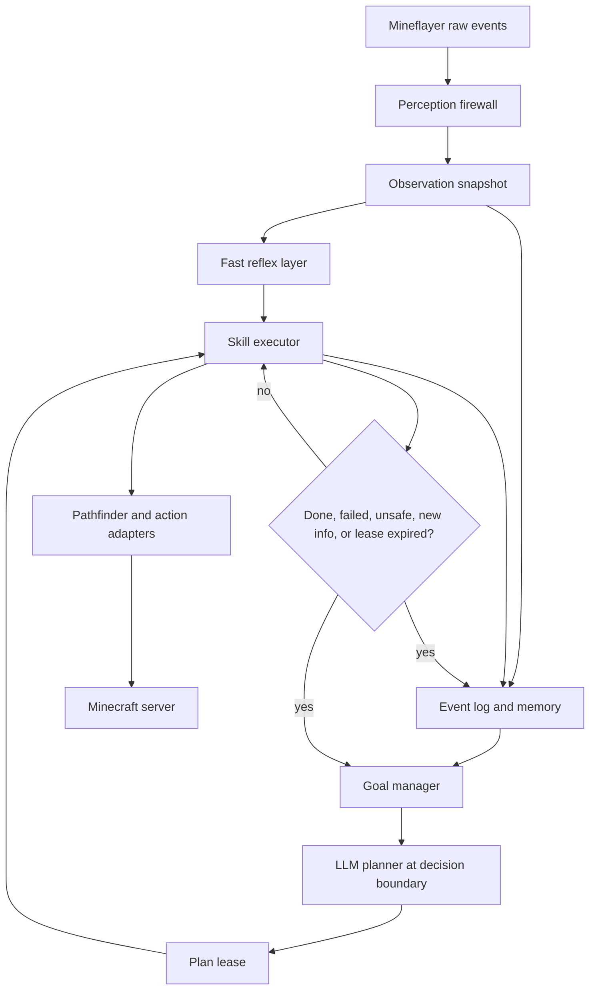
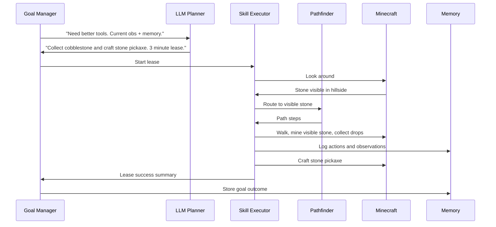

# Control Loop

This document explains how the agent moves from "thinking" to "doing" without sending every tiny action to the LLM.

## Core Idea

The LLM should make decisions at goal and plan boundaries. The body should handle moment-to-moment execution.

The agent should not ask the LLM every tick:

- "Should I walk forward?"
- "Should I jump?"
- "Should I mine this block for another 0.2 seconds?"

Instead, the LLM should choose tasks like:

- "Collect 16 logs from visible or newly discovered trees."
- "Return to the remembered shelter and craft a stone pickaxe."
- "Dig a safe staircase down to Y -58, placing torches every 8 blocks."
- "Explore west for 3 minutes, favoring high ground and stopping if food drops below 8."

The deterministic body then executes that plan until it succeeds, fails, becomes unsafe, or reaches its time/action budget.

## Flow



## Layers

### Fast Reflex Layer

Runs without the LLM.

Cadence: every game tick or frequent local event.

Responsibilities:

- stop walking near lava, cliffs, drowning, or lethal falls
- fight or flee immediate hostile threats
- eat if food is critically low
- cancel a skill if the world changes under the bot
- record urgent events

The reflex layer is not "smart." It is safety and interruption logic.

### Skill Executor

Runs without the LLM after receiving a plan lease.

Cadence: continuous while a skill is active.

Responsibilities:

- run deterministic skills
- call pathfinding for known targets
- mine, craft, place, eat, inspect, and move
- log attempts and outcomes
- stop on timeout, failure, new information, or danger

### Goal Manager

Usually runs without the LLM, then calls the LLM only when needed.

Cadence: after important events, skill completion/failure, or lease expiry.

Responsibilities:

- track current goal
- decide whether current work should continue
- decide whether an LLM call is worth making
- gather the compact state packet for the LLM

### LLM Planner

Runs at decision boundaries.

Responsibilities:

- pick or revise goals
- create a plan lease
- explain reasoning in terms of observations, memory, needs, and external research
- avoid raw action spam

## Plan Leases

A plan lease is permission for the body to run a plan for a bounded amount of time or work.

Example:

```json
{
  "goal": "Collect enough wood for basic tools and a small shelter",
  "steps": [
    "look around for visible trees",
    "walk to the nearest visible tree",
    "mine logs until 16 logs are collected or no visible logs remain",
    "collect dropped logs",
    "return to the remembered start point"
  ],
  "budget": {
    "max_seconds": 180,
    "max_blocks_mined": 24,
    "max_distance_from_start": 80
  },
  "stop_conditions": [
    "health below 12",
    "food below 8",
    "hostile mob within unsafe range",
    "night begins and no shelter exists",
    "no tree is visible after exploration"
  ],
  "report_back": [
    "logs collected",
    "tools crafted",
    "new landmarks observed",
    "failures or dangers"
  ]
}
```

The body may do many small Mineflayer actions under one lease. It must not invent a new high-level goal without going back through the goal manager.

## LLM Call Cadence

These are starting heuristics, not hard laws.

| Situation | LLM call? | Why |
| --- | --- | --- |
| Game tick, movement tick, digging progress | No | deterministic execution |
| Immediate danger | No | reflex layer must respond faster than an LLM |
| Skill succeeds | Maybe | continue if next step is already leased, otherwise replan |
| Skill fails twice in a row | Yes | needs diagnosis or alternate plan |
| New important observation | Maybe | if it changes the goal, otherwise log it |
| Player asks a simple status question | Maybe not | answer from active goal and memory |
| Player asks a nuanced question | Yes | social response needs context and personality |
| New goal selection | Yes | this is where personality and judgment matter |
| Internet research needed | Yes, via research tool | only for general knowledge |
| Periodic reflection | Yes | compress experience and update preferences |

Practical starting cadence:

- reflexes: every tick or event
- observation snapshots: about 1 to 5 times per second while active
- skill progress logging: every major substep, not every tick
- tactical LLM planning: every 30 seconds to 5 minutes, depending on task volatility
- strategic LLM reflection: every 10 to 30 minutes or at session end

## How Long Can The Body Run Without The LLM?

It depends on how open-ended the task is.

Short leases, 5 to 30 seconds:

- flee danger
- eat food
- inspect an area
- walk to a visible block
- mine a single visible block

Medium leases, 30 seconds to 5 minutes:

- chop visible trees
- gather exposed stone
- return to base
- craft a known recipe chain
- explore toward a nearby landmark

Long leases, 5 to 15 minutes:

- dig a staircase mine
- branch mine using a fixed pattern
- build a small blueprint
- farm a known area
- organize known storage

Long leases need strong stop conditions. The point is not to ask the LLM constantly; the point is to avoid sleepwalking through changed conditions.

## Pathfinding Without Omniscience

Pathfinding answers:

"Given a known target, how do I get there?"

It does not answer:

"Where are diamonds?"

The planner must produce a legitimate target first. Valid target sources:

- currently visible block/entity/item
- remembered coordinate from prior observation
- player-provided location
- current goal anchor, such as "home" or "mine entrance"
- exploration frontier selected from observed terrain
- generated search waypoint from a strategy

Invalid target sources:

- hidden block search
- raw chunk scan
- seed lookup
- server files

## Exploration Targets

When the bot does not know where to go, it should choose an exploration policy, not a hidden destination.

Examples:

### Find Trees

1. Look around.
2. If trees are visible, pathfind to the nearest visible tree.
3. If no trees are visible, choose a visible high-ground or open-terrain waypoint.
4. Move there.
5. Look around again.
6. Repeat until trees are observed or the lease expires.

### Find Diamonds

The agent never pathfinds to hidden diamonds.

It can:

1. Research or remember a good mining Y level for the target version.
2. Travel to a known mine entrance or dig a safe staircase.
3. Generate a branch-mining pattern.
4. Mine only reachable blocks according to the pattern.
5. Observe newly exposed blocks.
6. Mine diamond ore only after it becomes visible.

### Find A Place To Build

1. Define preferences: flat-ish, safe, near resources, not too far from spawn or base.
2. Explore visible terrain in bounded steps.
3. Score observed candidate areas.
4. Pick the best known candidate.
5. Pathfind to that candidate.

## Example: From Goal To Body Actions



## Rule Of Thumb

The LLM should decide "what kind of thing am I trying to do and why?"

The body should decide "how do I take the next legal step?"

Pathfinding is part of the body. Exploration strategy is part of the plan. Hidden knowledge is part of neither.
